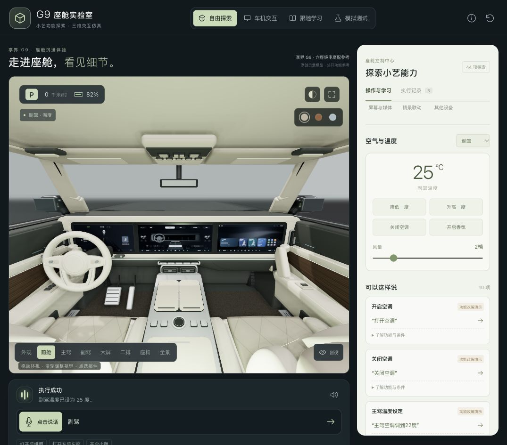

# G9 座舱实验室

一个车内外共用同一模型，可以进入车内环视、点选部件和通过中文指令操作的三维座舱教学模拟器。参考享界 G9 六座纯电高配的公开功能，把“理解请求 → 检查条件 → 模拟执行 → 状态反馈”展示出来。

**这是独立教育模拟作品，不是华为、享界或鸿蒙智行的官方系统，不连接真实车辆。** 可切换本地规则与 DeepSeek（深度求索）真实接口理解中文指令；两者均经过本地条件检查后模拟执行，未接入原生小艺。三维座舱是原创参数化近似模型，未经实车测量，不是原厂 CAD（计算机辅助设计）或汽车之家模型，也不是完整车机界面复刻。



[车身外观](docs/preview-exterior.jpg) · [开门查看同一内饰](docs/preview-unified-open.jpg) · [大屏空调触控](docs/preview-screen-climate.jpg) · [座椅近景](docs/preview-seats.jpg) · [二排屏幕展开](docs/preview-rear.jpg) · [建模说明与参考](docs/modeling.md)

[车机桌面](docs/preview-infotainment-home.jpg) · [座椅二级页](docs/preview-infotainment-seats.jpg) · [屏内确认](docs/preview-infotainment-confirm.jpg) · [模拟路线](docs/preview-infotainment-navigation.jpg) · [20 页参考及路径](docs/infotainment-reference.md)

## 可以体验什么

- **同一辆车**：详细座舱直接装入外壳；打开车门可看到同一组座椅，内门板与外门共同转动，透过玻璃可以观察车内。剖视用于临时移除遮挡。
- **独立屏幕**：中控、副驾和后排屏分别保留当前页面与返回历史，同时共享车辆状态；切换中控页面不会把其他屏幕一同替换。
- **一级与二级车机**：顶部“车机交互”可放大操作桌面、应用中心、设置、车辆、门窗、座椅、灯光、前后排空调、空气管理、音乐、声音、导航等页面；支持逐级返回、屏内确认、状态反馈及可拖动滑条。三维大屏与放大视图使用同一绘制器和车辆状态。界面布局与功能路径的证据见[车机参考](docs/infotainment-reference.md)，缺少完整截图的页面为原创改编。
- **模拟完整流程**：从座椅入口选择座位并调整舒适功能；进入门窗页开门、确认或取消；从模拟地点搜索进入路线预览、开始及结束演示。配置高德 Web 服务（服务端接口）密钥后可搜索真实地点并预览返回路线，底图仍为原创示意图；未配置时为明确标注的虚构地点演示。媒体不播放真实音源，连接页不扫描或配对设备，音效预设只改变本地演示选项。
- **自由探索**：切换外观、前舱、主驾、副驾、二排、大屏、座椅和全景视角。外观提供车头、侧面和车尾三个观察位置。车内拖动环视、滚轮改变视野；外部拖动旋转、滚轮缩放，也可点选部件或开启剖视。
- **座舱外观**：结合官方手册图与汽车之家全景可见细节重建贯通屏幕面板、圆形三辐方向盘、两端竖风口、中央双横风口、旋钮与四拨键中岛、双圆扬声器与竖向门拉手；以程序生成皮革颗粒、缝线和金属细节。支持橄榄灰、雅丹棕、云沙蓝三种近似内饰配色及日夜氛围；使用中性摄影棚、环境反射和 SSAO（屏幕空间环境光遮蔽）表现层次，具体边界见[建模说明](docs/modeling.md)。
- **座舱控制**：门窗、遮阳帘、座椅位置与靠背、加热、通风、按摩、分区温度、风量、阅读灯、氛围灯、后排屏、香氛、制氧、媒体、儿童锁及充电口盖。各位置支持项有差异，第三排没有独立升降车窗，通风和按摩也不开放。
- **情景联动**：影院、小憩、露营的简化演示，以及退出后的模拟恢复。模式、设备配置、挡位与电量会影响结果。
- **跟随学习**：用分步任务体验控制和“再低一点”等上下文指代。
- **模拟测试**：改变发话位置、挡位、车速、电量、硬件能力与故障条件；运行内置场景，观察成功、澄清、拒绝、失败及取消。
- **执行记录**：查看理解、条件检查及执行回执；预览、复制或下载本次交互或测试结果为 JSON（结构化数据）文件。

媒体控制只改变模拟播放状态，不连接歌曲或影片服务。制氧默认未配置，可在模拟测试中启用；这项原型默认值不代表官方最高配的实际销售配置。

## 本地运行

准备 Node.js（JavaScript 运行环境）和 npm（包管理工具）。运行环境需支持 ES 模块、内置测试运行器及 `structuredClone`；项目未声明全版本兼容。

在本项目目录执行：

```sh
npm install
npm run dev
```

打开 [本地体验页面](http://127.0.0.1:8940)。服务默认只监听本机回环地址。`npm start` 与 `npm run dev` 使用同一启动入口。

如使用仓库已有的 pnpm（包管理工具）锁文件，可改用：

```sh
pnpm install --frozen-lockfile
pnpm dev
```

端口占用时，可在 macOS / Linux（操作系统）的终端指定其他端口：

```sh
PORT=8941 npm run dev
```

从终端退出服务可按 `Ctrl+C`。请通过本地网页服务访问，不要直接双击 `index.html`；页面使用浏览器模块导入及本地依赖路径。

## 接入自己的模型与地点服务

在项目根目录创建 `.env.local`，按下列字段配置；环境变量也可覆盖文件。值只由服务端读取，不写入静态网页、浏览器配置或执行记录。文件已被 Git（版本管理）忽略，服务也禁止通过网页读取。

```dotenv
DEEPSEEK_API_KEY=填写自己的密钥
DEEPSEEK_BASE_URL=https://api.deepseek.com
DEEPSEEK_MODEL=deepseek-flash
AMAP_WEB_KEY=填写高德Web服务类型密钥
```

修改后重启本地服务。页面自动选择已配置的 DeepSeek，可在语音控制台切回本地规则。状态中的“已配置”仅表示读到了配置；一次真实请求通过后才显示“已验证”。模型出错或超时会明确提示未执行，不会悄悄用本地规则伪装成功。开门确认、目标补充、触控及内置回归场景由本地执行器处理。

高德密钥须为 Web 服务类型，不能用 JavaScript API（网页地图接口）密钥替代。`10009` 表示请求接口与密钥绑定平台不符，参见[高德官方错误码说明](https://lbs.amap.com/api/webservice/guide/tools/info)。本次复用旧配置的真实检索与规划均返回该错误，见[接口实测记录](docs/api-verification.json)；在替换正确类型密钥之前，页面显示错误，不冒充真实路线。

地点搜索可输入城市；路线固定从杭州东站演示坐标出发。已完成接口和渲染适配并不等于完整导航：没有真实底图瓦片、定位、持续路况、转向播报或实车导航接管。公网部署前需另行提供用户鉴权和调用配额，本地服务仅绑定回环地址。纯静态发布会保留本地规则和演示地点，不包含密钥或在线接口。

## 先试这几句话

每个场景可先点击页面右上角重置，恢复初始车态。重置保留本次交互记录，刷新页面则重新开始会话。

| 输入 | 观察内容 |
| --- | --- |
| 打开后排娱乐屏 | 屏幕展开及状态反馈。 |
| 副驾空调调到22度 | 指定位置和数值。 |
| 再低一点 | 在上一条温度指令之后，沿用目标继续调节。 |
| 现在副驾温度多少度 | 只查询状态，保留后续调温上下文。 |
| 左后车窗打开了吗 | 只查询车窗状态，不触发开窗。 |
| 打开左后车窗 | 指定车窗的玻璃升降。 |
| 打开副驾车门 | 停车状态下进入确认，再输入“确认”或“取消”。 |
| 开启小憩模式 | 在停车挡且电量条件满足时，观察多设备联动。 |
| 打开制氧机 | 默认配置缺失时应提示无法执行。 |

进入“模拟测试”，设置行驶挡或车速后再次尝试开门，观察条件拒绝。发话位置由界面手动设置，不能视为真实麦克风声源定位。规则解析只覆盖已实现的词法、动作和上下文范围，任意自由表达并不保证能理解。

## 语音输入与数据范围

`speech.js` 使用浏览器的 `SpeechRecognition` / `webkitSpeechRecognition`（语音识别接口），中文语言设为 `zh-CN`，点击麦克风后识别一轮；播报使用 `speechSynthesis`（语音合成接口）。支持文字输入、示例按钮和触控作为替代入口。

**真实麦克风识别尚未完成实测验证。** 接口存在不等于识别服务可用：还受浏览器版本、麦克风权限、设备、网络和语言服务影响。部分浏览器可能将音频发送至其识别服务，本项目没有强制启用设备端识别，因此不承诺语音全程离线或音频不离开设备。参见 [MDN 语音识别说明](https://developer.mozilla.org/en-US/docs/Web/API/SpeechRecognition)。

播报声音取决于设备可用的中文语音，可在页面关闭播报；不包含原厂小艺音色。参见 [MDN 语音合成说明](https://developer.mozilla.org/en-US/docs/Web/API/SpeechSynthesis)。本项目未实现常驻唤醒词、原厂声纹、多音区拾音、方言专项识别或原车连续聆听。

本地规则解析、模拟状态、学习进度和执行记录保存在当前页面内存中。选择 DeepSeek 时，当前文字指令和必要的模拟车态/指代上下文发送至 DeepSeek 官方接口；密钥仅用于服务端向对应官方接口鉴权，不放入模型提示词；不发送历史记录或个人文件。高德检索只发送关键词、城市与路线坐标；杭州东站是固定演示起点，没有读取用户位置。本项目没有账户服务、持久化数据库或自行编写的录音上传接口；主动导出时会生成包含指令和结果的本地文件。浏览器语音服务及外部来源链接有各自的数据处理范围。

## 测试与构建

```sh
npm test
npm run build
```

- `npm test` 运行 `tests/` 中的本地引擎、语音适配、大屏交互和车辆装配测试，覆盖状态、指令、约束、上下文、模拟语音回调、屏幕触控区域、内外装配契约、模型格式检查、接口错误与过期响应取消。自动化接口测试使用测试替身，真实调用另记。终端输出才是对应代码版本的实际测试结果。
- 页面内“运行测试集”用于交互演示，可单独查看或导出结果。
- `npm run build` 生成 `dist/` 静态网页及本地三维依赖，可交给静态网页服务器访问。构建命令不会自动发布网站，也不会创建 GitHub（代码托管平台）仓库。

当前包含第五版交互与材质更新：内外统一装配，并按官方手册界面布局原创重绘可触控大屏。本轮已验证自动测试、文字指令确认开门后的同一内饰、屏幕与控制面板的温度同步，以及剖视关闭还原；具体结果及待验证项见 [验证记录](docs/validation.md)。第三版独立展示内外模型的描述与截图属于历史记录。

自动化测试和页面模拟成功不能证明真实语音识别、原生小艺或实车执行成功。本说明不预置通过率；三维外观、浏览器权限和麦克风链路应分别验证。

## 项目结构与扩展入口

| 文件 | 职责 |
| --- | --- |
| `app.js`、`style.css`、`index.html` | 页面、学习任务、模拟测试和状态呈现。 |
| `scene.js` | Three.js（三维图形库）场景组装、车内环视、视角切换、部件选择及动作动画。 |
| `studio.js` | 程序材质、三种配色、中性摄影棚灯光、环境反射与屏幕空间环境光遮蔽。 |
| `model-dashboard.js` | 一体屏台、仪表台、方向盘、中岛及既有设备的可视部件。 |
| `model-exterior.js` | 车身曲面、车轮、灯组、唯一外门铰链与玻璃。 |
| `vehicle-assembly.js` | 内外统一装配、内门板迁移、重复外皮清理与剖视恢复。 |
| `screen-ui.js` | 按手册布局原创重绘的大屏与可点击区域。 |
| `screen-session.js` | 页面历史、逐级返回、本地显示偏好和待确认状态。车辆状态始终由引擎持有。 |
| `model-seats.js` | 座椅曲面、肩托、侧翼、包边与缝线。 |
| `model-body.js` | 地板、门内饰、车窗、立柱、顶棚与车体围合。 |
| `engine.js` | 状态初始化、中文规则解析、条件检查、执行与上下文。 |
| `speech.js` | 浏览器识别和语音合成适配。 |
| `catalog.js` | 功能示例、教学解释、条件和证据等级。 |
| `server.mjs`、`server-config.mjs` | 本机服务入口、来源检查、静态文件限制与服务端配置。 |
| `server-ai.mjs`、`server-maps.mjs` | DeepSeek 规划检查、高德地点与路线适配。 |
| `services.js`、`scripts/build.mjs` | 浏览器请求取消、过期结果保护与静态构建。 |
| `tests/` | 引擎、模拟语音、大屏交互、页面会话和车辆装配验证用例。 |
| `docs/evidence.md` | 车型、官方页码、配置与仿真边界。 |
| `docs/modeling.md` | 造型改进、视觉参考、渲染方式与精度局限。 |
| `docs/infotainment-reference.md` | 一级与二级车机页面的官方页码、图像依据、文字路径与设计补充。 |

引擎提供 `createInitialState()`（创建状态）、`executeCommand()`（执行文本指令）、`performAction()`（执行结构化动作）、`performActions()`（最多四个动作原子执行），返回新的状态、动作、检查步骤及回执；语音与触控走同一个执行器。扩展功能时，应同时补充目标设备、状态、条件、来源级别和相关验证。

## 官方依据与原创设计

研究基线为《享界 G9 纯电版使用说明书》G9OM26C1，2026 年 8 月版，以及官方车型和配置页面。完整出处见 [功能证据说明](docs/evidence.md)。

造型参考另见[享界 G9 官网](https://hima.auto/xiangjie/g9/)、[官网座椅视觉参考](https://hima.auto/dam/hima-site/cn/xiangjie/g9/images/comfortable/xiangjie-g9-seat-1.jpg)及[汽车之家公开文章](https://www.autohome.com.cn/article?id=OoAzsCnQ4XY%3D)。本轮实际查看了官方手册第 15—18 页；大屏布局另参考第 21、34、44、48、108、289 页，车辆页依据第 41—42 页说明作设计改编，逐项边界见[建模说明](docs/modeling.md)。同时参考用户提供的[外观全景](https://pano.autohome.com.cn/car/ext/78660?_ahrotate=1)与[内饰全景](https://pano.autohome.com.cn/car/pano/78136?_ahrotate=1)。全景分别标注增程 Ultra+ 六座和增程 Ultra+ 五座；项目保留[指定图集](https://www.autohome.com.cn/cars/imglist-x-x-8537-78750-x-x-x-x-x-1.html)对应的纯电六座基线，只用全景可见部分校准造型，不宣称各配置完全一致。项目未加载或分发这些网站的三维模型及参考图片。参考资料不构成尺寸、材质色差、动作精度或渲染性能证明。

目录区分 `official`（G9 官方资料有依据）、`adapted`（基于资料改编）和 `design`（原型设计）。例如，原车“指哪控哪”包含二排手势与语音条件，用具名文字或点击来替代手势属于改编；三维模型的角度、颜色和速度也不代表厂商规格。

本项目不是原厂完整意图库，也没有实现完整导航、电话、日程、抬头显示、全地形驾驶或真实车辆控制。官方手册收录某能力，不意味着所有硬件配置与软件版本都能使用。

## 许可

本项目原创代码、自建近似几何和原创文档采用 [MIT 许可](LICENSE)。第三方依赖依其自身许可使用，见 [第三方声明](THIRD_PARTY_NOTICES.md)。

华为、享界、鸿蒙智行、小艺等名称和标识，以及官方手册、图片、软件和工程模型的权利归相应权利人所有，不纳入本项目 MIT 授权。仓库不附带完整官方手册；资料链接不表示品牌合作、授权或背书。
